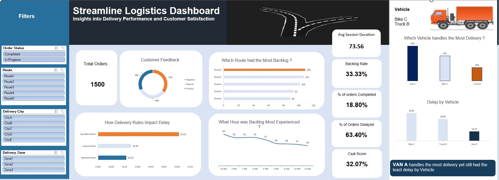

# Optimizing-Order-Fulfillment
An Excel-based logistics analytics project examining order backlogs, delivery delays, route and vehicle performance, and customer feedback through data analysis, pivot tables, KPIs, and an interactive dashboard.

## Project Overview

How can a logistics company reduce delivery backlogs, improve resource allocation, and enhance customer satisfaction?

This project examines 1,500 delivery orders for Streamline Logistics Solutions to identify operational bottlenecks, assess delivery performance, and uncover factors contributing to delays. Using Microsoft Excel, I analysed order status, delivery delays, vehicles, routes, drivers, and customer feedback, then developed an interactive dashboard to turn the findings into actionable business recommendations.

## Dashboard Preview

*Interactive Excel dashboard showing key order fulfillment metrics and operational performance.*

## Business Problem

Streamline Logistics Solutions was experiencing growing order backlogs, delivery delays, limited visibility into order progress, customer dissatisfaction, and increasing operational costs.

The objective was to use delivery data to identify performance gaps and support better operational decisions.

## Key Questions Explored

- How many orders are still in progress, and how many meet the backlog definition?
- At what time of day do the most backlogs occur?
- Which vehicles handle the highest delivery volumes, and how do their delays compare?
- Which routes show weaker delivery performance?
- How do delivery allocation rules and customer feedback relate to operational performance?
- What actions could improve delivery efficiency and customer experience?

## Tools & Techniques

- **Microsoft Excel:** Data analysis and dashboard development.
- **Data preparation:** Organising delivery records and creating calculated fields.
- **Excel formulas:** Classifying delayed orders and identifying backlogged orders.
- **Pivot tables:** Summarising performance by time, vehicle, route, driver, and allocation rule.
- **Data visualization:** Charts and an interactive dashboard.
- **Business analysis:** Interpreting findings and developing operational recommendations.

## Key Performance Indicators

| KPI | Result |
|---|---:|
| Total orders analysed | 1,500 |
| Orders in progress | 767 |
| Backlogged orders | 500 |
| Backlog rate | 33.3% |
| Csat Score | 32.07% |

**Backlog definition:** An order was classified as backlogged when its status was *In Progress* and its recorded delay exceeded 10 minutes. Therefore, the 767 orders represent all orders still in progress, while 500(33.3%) of those orders met the backlog classification rule. The remaining 267 did not exceed the defined delay threshold.

## Key Findings

- **Backlog concentration:** 500 orders (33.3% of the analysed records) met the backlog classification rule.
- **Peak backlog period:** 10 AM recorded the highest number of backlogged orders, with 69 cases.
- **Vehicle performance:** Van A handled the highest delivery volume (530 orders) and recorded the lowest average delay among the three vehicle types, at approximately 14.15 minutes.
- **Route performance:** Route 1 and Route 2 recorded 107 and 109 backlogged orders respectively, highlighting areas that require further investigation.
- **Allocation rules:** Expedited allocation recorded a higher average delay (15.03 minutes) than Standard (14.23 minutes) and Custom (14.30 minutes).
- **Customer feedback:** The analysis recorded 481 positive, 490 neutral, and 529 negative feedback responses, indicating an opportunity to improve the delivery experience.

## Business Recommendations

Based on the findings, the following actions are recommended:

1. **Improve resource planning:** Review staffing and vehicle allocation around peak periods, particularly 10 AM.
2. **Investigate route bottlenecks:** Examine traffic conditions, road accessibility, and other operational constraints affecting Routes 1 and 2.
3. **Optimize vehicle allocation:** Review the causes of higher delays associated with Bike C and Truck B while considering Van A's delivery performance.
4. **Review expedited deliveries:** Assess whether vehicle selection, route assignment, and delivery conditions are affecting expedited orders.
5. **Strengthen customer communication:** Improve order tracking and provide timely delivery updates to reduce customer uncertainty.

## Project Deliverables

- [Delivery_orders_dataset.xls](https://github.com/ALLIANCEMARIE/Optimizing-Order-Fulfillment/blob/8bfe0af70661a06c29b0e3352bc3d92801844a71/Delivery_orders_dataset.xlsx)t
- [order_fulfillment_analysis.xlsx](https://github.com/ALLIANCEMARIE/Optimizing-Order-Fulfillment/blob/e690271fcd721f7db67a4a533e6010f82081c3dd/Order_fulfillment_analysis.xlsx)

## Limitations & Next Steps

This analysis provides a snapshot of delivery operations using the available records. Further investigation would benefit from additional information on traffic conditions, road accessibility, driver workloads, and reasons for delivery delays.

Future improvements could include automated KPI reporting using Excel Office Scripts and extending the analysis into Power BI for more advanced reporting.

## Author

**Gounou Marie Alliance**  
Data Analyst | Excel | SQL | Python | Power BI | Tableau

[LinkedIn](https://www.linkedin.com/in/mariealliancegounou/) | [GitHub](https://github.com/ALLIANCEMARIE)
